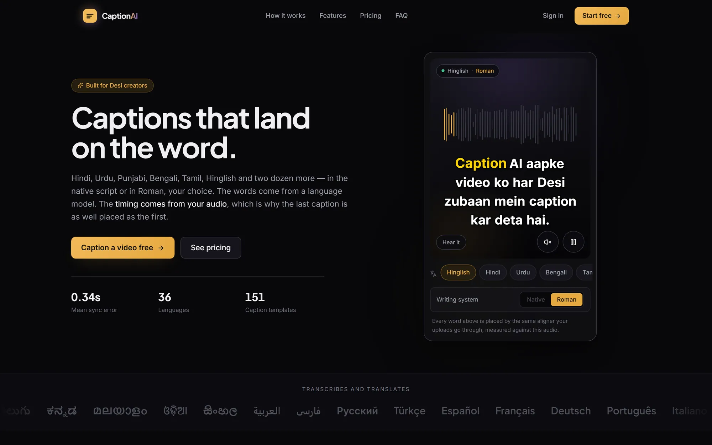
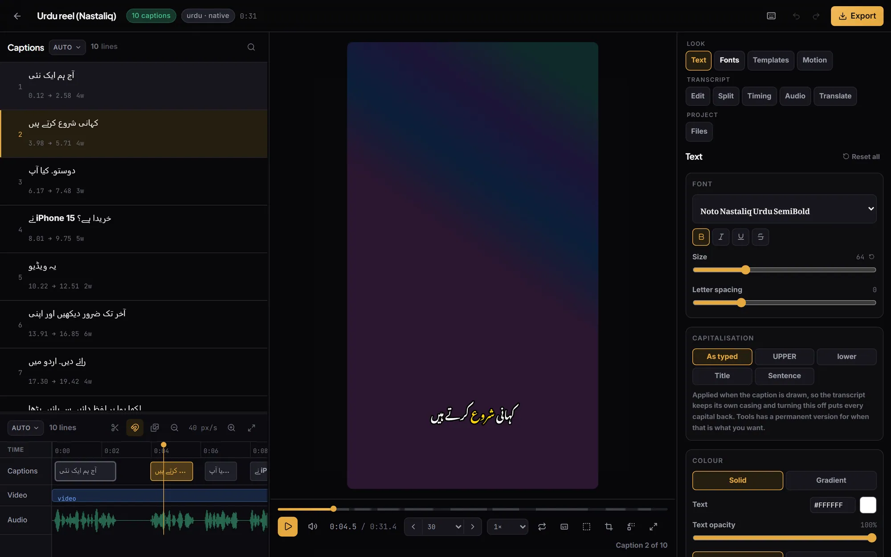
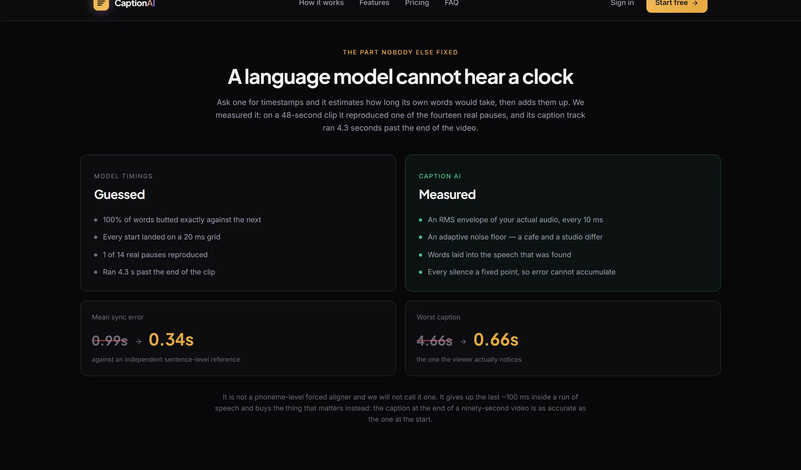
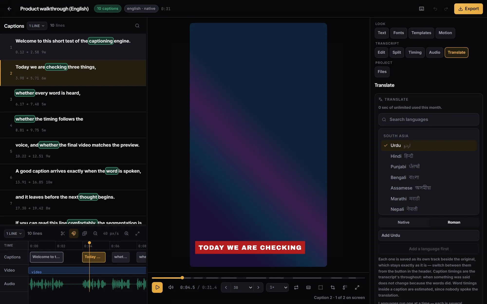
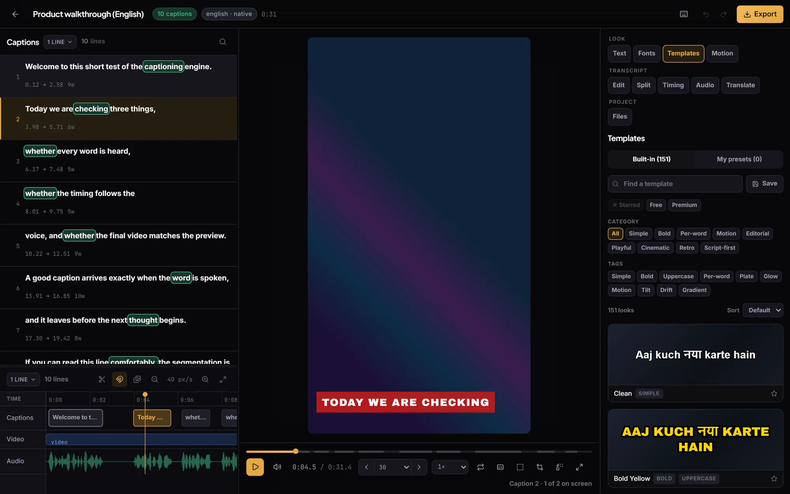
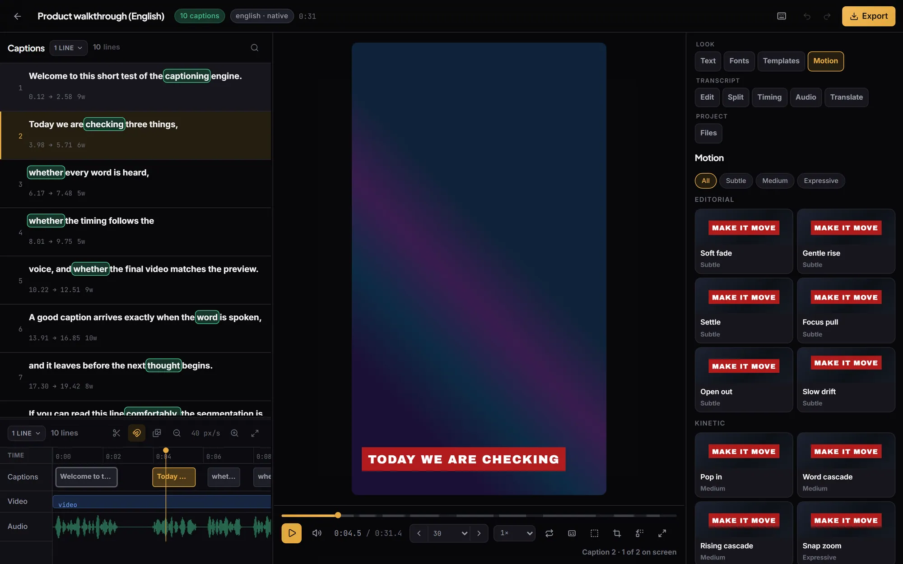

  

# Caption AI

**A captioning web app for South Asian video creators, with Gemini transcription, timing measured from the audio and a full caption editor.**

> **Portfolio showcase.** The source code is private. This repository presents the project with screenshots and a technical overview. Full case study: **[farhadnazir.com/projects/caption-ai](https://farhadnazir.com/projects/caption-ai/)**

| | |
|---|---|
| **Type** | AI video captioning SaaS |
| **Categories** | Web application, SaaS product |
| **Platforms** | Web, Backend & API |
| **My role** | Developer in a three-person team |
| **Status** | In development |
| **Timeline** | 2026 |

## Overview

Caption AI is a web platform that turns a video into styled, word-timed captions in 36 languages. It focuses on Urdu, Hindi, Punjabi, Bengali, Tamil and code-switched languages such as Hinglish and Roman Urdu, and lets the user choose native or Roman script for each one.

Google Gemini transcribes the audio, then the engine re-times every word against the speech it measures in the waveform. A React editor lets users restyle, retime, translate and clean up audio before exporting a burned-in MP4, a transparent caption layer for video editors, or subtitle files. Around the editor sit accounts, Stripe plans and usage quotas, referrals, support chat, transactional email and an operator panel.

This is a team project with three developers. I authored the four most recent milestones (M17 to M20, roughly 22,000 lines): matching the preview and exported animation, motion presets, transcript coverage checks, the keyboard shortcut system and autosave, right-to-left caption rendering, session and upload security, performance work in the editor, server deployment files and font-driven text sizing. The earlier milestones (the engine baseline, the web foundation, the original editor, billing, admin, email and support) were committed by the other two developers.

**Who it is for:** Short-form video creators and editors working in South Asian languages, plus professional editors who want caption layers for Premiere Pro or DaVinci Resolve.

## The problem

Most captioning tools handle Urdu, Hindi, Punjabi and mixed-language speech poorly, and few let the creator decide between native script and Roman script.

Language models also invent word timestamps. On a 48-second Hinglish clip, the team found that Gemini's timings sat on a 20 ms grid with every word touching the next, reproduced only 1 of 14 real pauses, and ran the caption track 4.3 seconds past the end of the video, so the last captions were never shown.

## The solution

The product separates what was said from when it was said. Gemini returns the words in the chosen script. The engine then measures where speech actually happens in the audio and lays the words into those regions, weighted by estimated syllables. Every silence becomes a fixed point, so timing errors cannot build up across a long clip.

Captions are stored as structured objects with word timings and edited in a three-pane React editor. One style model drives three renderers (the CSS preview, the ASS file that FFmpeg burns in through libass, and plain subtitle formats), so what the user sees in the editor is what ends up in the exported file. My M17 milestone made the preview and the export run the same measured animation, and M20 tied text sizing to the actual font files.

## Key features

- **36 languages, native or Roman script.** Auto-detect plus 36 languages, including Urdu, Hindi, Punjabi, Sindhi, Pashto, Bengali, Tamil, Hinglish, Roman Urdu-English, Arabic and Persian. The script choice is enforced per language.
- **Timing measured from the audio.** Word timings from the model are re-aligned against speech regions detected in the waveform. On the team's sample clip, mean sync error fell from 0.99 s to 0.34 s. The same speech windows catch transcripts that stopped early or missed speech, so users are not charged for incomplete work.
- **Full caption editor.** Caption and word lists, a live preview, a timeline with drag-to-retime, split and merge, 50-step undo and autosave. I added the keyboard shortcut system, the single save indicator and windowed lists for long transcripts.
- **151 templates and 26 motion presets.** Templates apply like any other style change. Motion presets such as Soft fade, Pop in and Word cascade are limited to what libass can actually render, so the exported video matches the preview.
- **Right-to-left and complex scripts.** Urdu and Arabic lines are reordered in the engine, because libass lays text out left to right. Font coverage is checked per character, and 46 bundled font files include Noto Nastaliq Urdu.
- **Translation and audio cleanup.** Gemini translates captions into extra tracks without changing the timing, and two languages can be shown at once. An FFmpeg chain handles hum removal, denoising, de-essing, loudness and a steady music bed, with an original versus cleaned comparison.
- **Exports for creators and editors.** Burned-in MP4, transparent ProRes 4444 or green-screen caption layers for video editors, plus SRT, VTT, styled ASS and JSON with word timings.
- **SaaS business layer.** Accounts with email verification and password reset, five plan tiers with usage meters, Stripe checkout and webhooks, referrals, support chat and an operator panel.

## Screenshots

<table>
<tr>
<td width="50%" valign="top"> The three-pane editor with Urdu captions in Nastaliq script, rendered right to left.</td>
<td width="50%" valign="top"> The landing page explains why timing comes from the audio, not the model.</td>
</tr>
<tr>
<td width="50%" valign="top"> Translation tracks, each in native or Roman script.</td>
<td width="50%" valign="top"> 151 built-in templates, previewed with the real caption renderer.</td>
</tr>
<tr>
<td width="50%" valign="top"> Motion presets, limited to what the export renderer can reproduce.</td>
</tr>
</table>

## Architecture

Caption AI is one Node.js engine and one React client. The engine is structured as config, services, processors, store and server, and serves everything under /api through a small hand-written router. A Vite, React 19 and TypeScript single-page app is the only client, with the operator panel code-split.

PostgreSQL holds accounts, billing, usage meters and render jobs, with numbered SQL migrations applied at startup. Media and project files stay on disk per user and never go into the database. FFmpeg with libass handles audio extraction, waveforms, audio cleanup and caption burn-in. The engine has only four runtime dependencies, and the project carries a large automated test suite that runs against a real Postgres database.

- **Words from the model, timing from the signal.** Speech regions are found from an RMS envelope sampled every 10 ms with an adaptive noise floor and hysteresis. Words are placed into those regions by syllable estimates, with the model's own durations used only as a tiebreak.
- **One style model, three renderers.** The same style definition produces the CSS preview, the ASS file for libass and the subtitle formats, sized against a 1920×1080 reference frame and pinned by golden-output tests. In M17 I made the preview and the exported file run one measured animation.
- **Right-to-left caption rendering.** In M19 I added bidi reordering in the engine for Urdu and Arabic captions, because libass orders text runs left to right and would otherwise scramble mixed-direction lines.
- **Durable render jobs.** MP4 exports are Postgres-backed jobs that survive a process restart. The schema allows only one render per project, and every FFmpeg pass runs asynchronously through a single runner with separate lanes for heavy and light work.
- **Auth and security hardening.** Passwords use scrypt, and verification and reset tokens are single-use and hashed. In M19 I added hashed session tokens, secured upload paths and added billing recovery and housekeeping jobs.
- **Editor performance.** The playback clock lives outside React state, and the caption lists and timeline are windowed, so long transcripts stay responsive while the video plays.
- **Prepared for a single server.** I wrote the nginx site config and systemd service unit for deployment. A Postgres backup timer and a preflight check script sit alongside them. The product has not been deployed yet.

## Tech stack

`Node.js` · `React` · `TypeScript` · `PostgreSQL` · `Google Gemini` · `FFmpeg` · `libass` · `Stripe` · `Tailwind CSS` · `Vite` · `Nginx`

## Results

- **0.34 s** Mean caption sync error, down from 0.99 s (Measured by the team on one sample clip against an independent sentence-level reference.)
- **0.66 s** Worst-case caption error, down from 4.66 s (Same sample clip and reference.)
- **1,250** Automated tests passing (Across 79 test files, run against a real PostgreSQL database.)
- **36** Languages supported (Plus auto-detect, with native or Roman script where a language has both.)

## Links

- Case study: https://farhadnazir.com/projects/caption-ai/

## About the developer

Built by **Farhad Nazir**, full-stack software developer in Riyadh, Saudi Arabia, and founder of [Techwine Solutions](https://www.techwinesolutions.com). I build SaaS platforms, business systems, and mobile and desktop apps.

[Portfolio](https://farhadnazir.com) · [LinkedIn](https://www.linkedin.com/in/farhadnazir) · [Email](mailto:farhadnazirksa@gmail.com) · [WhatsApp](https://wa.me/966536566380)

---

Screenshots are shown for portfolio purposes. Rights to each product and its branding belong to their owners. Screens marked "recreated" use demo data, so no real customer data appears.
